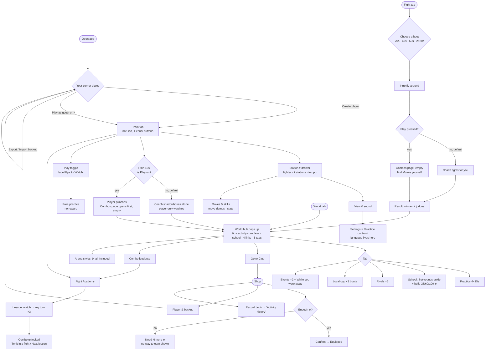
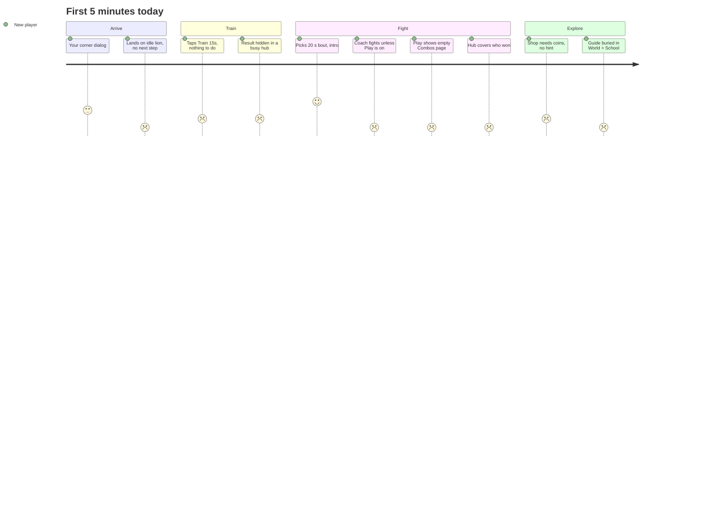
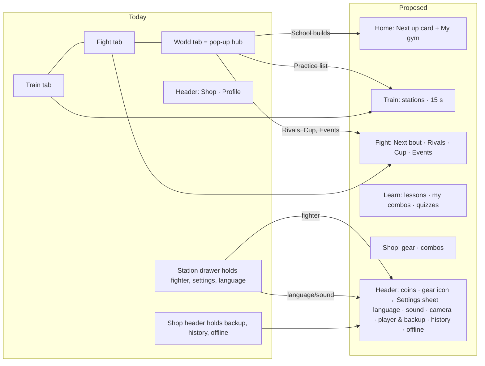
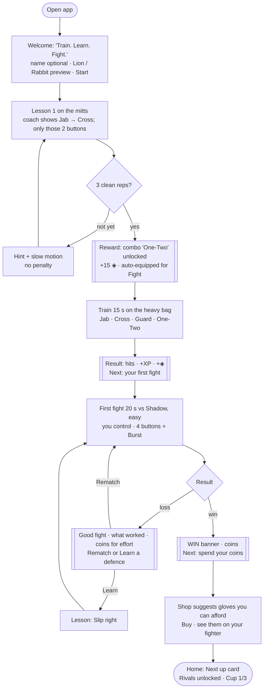
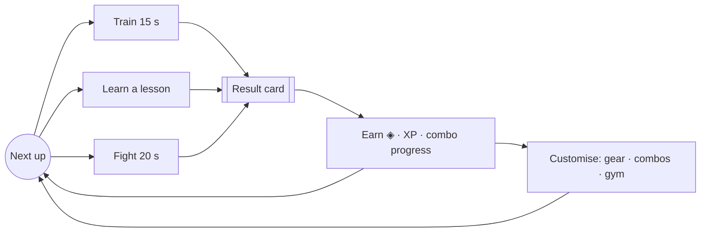
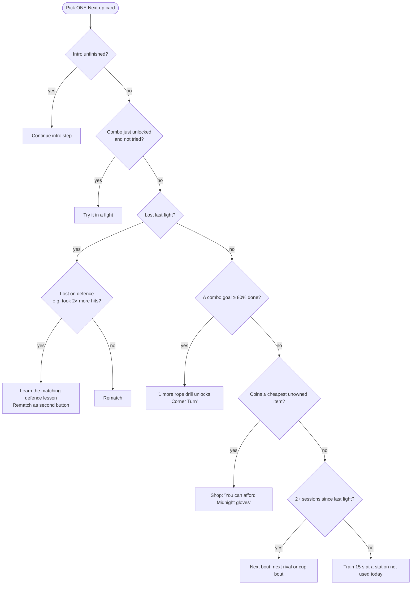
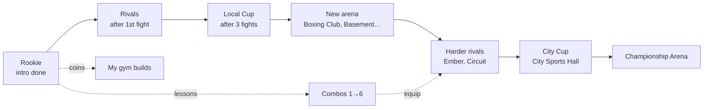

# Glory of the Ring — UX flows and decisions (GOTR-0031)

Status: proposal for the owner's review. No game code was changed. Visual version for a phone: [`ux-flows.html`](ux-flows.html).

**Evidence.** Build v1.19 (`b8426a2`), run locally and driven with Playwright as a brand-new player at 402×690 (touch) and 1366×768, English, with a Hebrew spot-check. Screenshots are in [`qa/gotr-0031/`](../../qa/gotr-0031/) and the helper scripts in `qa/gotr-0031/tools/`. Software WebGL in the test browser runs slowly, so I shortened timers in two places: the training clock was moved forward through `app.engine.career.active.seconds`, and the fight was stepped with `arena.fightView.step()`. Screens and rewards were not changed. The third Fight Academy repetition did not register at the low frame rate. The "Lesson passed" screen is described from the code (`fight-iq-ui.js`) and was not captured. Nothing was tested on a physical phone.

---

## 1. The game today: what a new player sees

| Screen | How you get there | What you can do | Where it leads | What changes |
|---|---|---|---|---|
| **Your corner** (first launch) | Opens by itself | Name + Create player · Play as guest · × · Export / Import backup | Train tab | Creates a local profile. × quietly makes a "Guest" |
| **Train tab** (home) | Default tab | Station ▾ · Train 15s · Play · Fight Academy · Side lock · Pause | See below | — |
| Station ▾ → "Training" drawer | Train tab | Tabs *Training* (Lion/Rabbit, 7 stations, Combinations / Variable rhythm / 1.0x), *Moves & skills* (11 move demos, Rookie stats), *View & sound* (camera, sound, Settings) | Back to game | Fighter, station, tempo |
| Settings → **"Practice controls"** | Station ▾ → View & sound → Settings | Language EN/HE/RU, a second sound toggle, "Lion", "Resume motion", "28-day plan 0/28" | — | Language |
| **Train 15s** | Train tab | Countdown on the button ("Finish · 15s") | Result inside the World hub (below) | +14 XP, +7 coins, "First Rhythm" ticked |
| **Play** toggle | Train or Fight | You control the fighter; the label changes to "Watch" | Moves / Combos / Defence pages (Combos page first, empty for a new player) | Without Train 15s: "Preview is free", no reward |
| **Fight Academy** | Train toolbar, World hub, Combo loadouts | 6 lessons (Watch → Repeat ×3 → Fight), 18 optional quizzes, 12 coach notes | Lesson on the stage; after passing, *Try it in a fight* / *Next lesson* | Unlocks a combo, +15 ◈ |
| **Fight tab** → "Choose a bout" | Fight tab | 20 s · 40 s · 60 s · 2×20 s | Fight against Shadow in the current arena | — |
| Fight | After choosing | Intro (Tap to skip), HUD, Burst ("After bell" → "Charging"), Side lock, Play toggle. **You control nothing until you press Play** | Result | — |
| Fight result | End of bout | "Shadow won · health decision", 3 judges, Round-by-round details, New fight | **Covered by the World hub at once** | +10 XP, 0 coins for a loss |
| **World hub** "Build your corner." | World tab, and pops up after *every* activity | Tip card · Activity complete · Last station · "Maya School" (Go to Club, Combo loadouts, Fight Academy, Arena styles) · tabs Practice / School / Rivals / Local cup / Events | Many | — |
| Hub › Practice | Hub | 4 × "15s · …" with Guided / Play | Training | — |
| Hub › School | Hub | **"Your first rounds" guide (Start guide / Skip guide)** · build Canvas marks 25 ◈, Focus board 60 ◈, Recovery corner 100 ◈ | Guide / build | Facilities |
| Hub › Rivals | Hub | Shadow, Ember, Circuit — "Face Ember · Play as Rabbit" | Fight (may switch your species) | Rival record |
| Hub › Local cup | Hub | 3 bouts, Enter cup, Watch bout | Cup fights | Cup progress |
| Hub › Events | Hub | Viral Combo Challenge, AI Coach Invitational, "While you were away" | Challenge | Event counters |
| **Shop** | Header button, "Go to Club" | Gloves · Shorts · Boots · Belts · Accessories · Combos; Buy with confirm; "Need N more ◈"; header also holds *Player & backup*, *Record book*, ⤓ | Confirm → Owned / Equipped | Coins → items |
| Record book | Shop header | Opens a dialog titled **"Activity history"** | — | — |
| ⤓ | Shop header | Downloads the offline pack ("Offline pack ready") | — | Offline cache |
| **Combo loadouts** | Hub, Loadouts links | Fight 3 slots, Training 5 slots; 6 combo cards, each with requirement + Buy + Learn in Academy | Academy / Shop confirm | Equip |
| Arena styles | Hub | 9 arenas, all "Included" | — | Fight arena |
| Profile (name) | Header | Same "Your corner" dialog: switch, create, guest, backup | — | Player |

### 1.1 Current flow with decisions

### 1.2 Friction map

How a first session feels, scored from the screenshots (5 = clear and exciting, 1 = lost).

| # | Friction (evidence) | Why a new player gets lost | Sev. |
|---|---|---|---|
| F1 | No first step after naming (`02-after-create`). The guide "Your first rounds" exists but sits in World → School (`07-hub-school`) | Four equal buttons on an idle lion; the one guided path is three taps away | High |
| F2 | *Train 15s* runs with the coach in control unless *Play* is on; the *Play* button then reads *Watch* (`05-train15-start`, `16-lesson-watch`) | Two buttons for one idea; the label shows the mode you are not in | High |
| F3 | Fights start under coach control; pressing *Play* opens the empty Combos page (`11-fight-play-controls`) | A new player watches their own fight, or sees no punch buttons | High |
| F4 | The World hub pops up after every activity. The reward card sits under a tip, and for a fight it hides who won (`06-train15-end`, `13-fight-result`, `14-fight-result-under`) | No celebration and no clear outcome | High |
| F5 | One idea, many names: School / Club / Boxing Club / Your corner; *Go to Club* opens the Shop (`25-go-to-club`); *Record book* opens "Activity history" (`23-record-book`); *Fight controls ▾* opens a drawer titled "Training" that starts at "03 / Your session" (`30-fight-controls-drawer`) | Labels don't predict where you go | Med |
| F6 | Each combo has three unlock routes (requirement, Buy, Academy), and "First Rhythm" names a lesson, a combo and a training tick (`22-lab`, `15-academy`, `06-train15-end`) | Unclear what to do to get a combo | Med |
| F7 | Language and settings are 3 levels deep (Station ▾ → View & sound → Settings → "Practice controls"), with a duplicate sound toggle and an unexplained "28-day plan 0/28" (`04-settings`) | A Hebrew or Russian speaker can't find the language switch | Med |
| F8 | Developer or legal copy on player screens: "No adaptive learning yet", "simulated practice: 0", "No bonus currency or mastery is awarded", "While you were away" on day one, "account service" (`07-hub-rivals`, `07-hub-events`, `01-first-launch`) | Too much text, and it lowers excitement | Med |
| F9 | Fight setup only asks for length; "40 seconds" and "2 × 20 seconds" look alike; opponent and arena are chosen elsewhere (`08-fight-tab`) | A choice without meaning | Med |
| F10 | All 9 arenas are "Included" from minute one (`24-arena-styles`) | Nothing to aim for | Med |
| F11 | The fighter choice (Lion/Rabbit) is hidden in the station drawer; rival cards switch your species ("Play as Rabbit") (`03-stations`, `07-hub-rivals`) | Identity is unclear | Low |
| F12 | Hebrew: "Train 15s" not translated, "Maya School" stays English; the World tab stays highlighted after the hub closes (`28-train-he`, `27-world-he`) | Polish and trust | Low |
| F13 | First launch offers Export/Import backup; × creates "Guest" silently (`01-first-launch`) | Choices that don't matter yet | Low |
| F14 | Shop: "Need 25 more ◈" with no way to earn; the Shop header holds Player & backup, Record book and ⤓ (`19-shop`) | Dead end; wrong home for settings | Low |
| F15 | Cryptic stats "0/3 · 15s", "0/0 · 20s"; "health decision" | No meaning | Low |

Duplicate paths: the Academy is reached from 3 places, the Shop from 2 (header and *Go to Club*), training from 3 (Train tab, Hub › Practice, *Return to station*), and the profile dialog from 2 (header and *Player & backup*). Dead ends: Shop when short of coins; a fight in Play mode with no combos; the result hidden under the hub.

---

## 2. Proposed experience

### 2.1 Principles
1. **One next step.** Home always shows a single *Next up* card with one primary button. Everything else is secondary.
2. **You play by default.** Train and Fight are always player-controlled. *Watch the coach* is a separate secondary action, not a toggle.
3. **Every activity ends on its own result card**: the outcome first, then the reward, then one next step. The hub never pops up by itself.
4. **One name per thing.** Gym (yours), Shop, Learn (Academy), Fight, History, Settings.
5. **Show features when they matter.** Locked tiles show a goal and progress ("Cup: win 3 fights · 1/3") instead of a wall of tabs.
6. Product rules stay as they are: free with no real money, 15-second training, 20-second fights, EN/HE/RU, phone first.

### 2.2 Navigation (IA)

**Home stays as it is** apart from the new card (the 3D gym and the fighter remain the backdrop). What moves: the World hub is split up. Rivals, Cup and Events go to **Fight**; gym builds go to **Home › My gym**; the Practice list goes to **Train**; Combo loadouts become **Learn › My combos**; Arena styles become an *Arena* row in fight setup. Settings, language, Player & backup, History and the offline pack go into one **Settings sheet** from the header. What disappears: the automatic hub pop-up, the Play/Watch toggle as the main control, Export/Import on first launch, the duplicate sound toggle, developer disclaimers, and "While you were away" on day one.

Phone layout: five top tabs (Home · Train · Fight · Learn · Shop) replace today's three, with icon plus word. On desktop the same tabs appear in the header.

### 2.3 First 5 minutes

Rules for the first session:
- "One-Two" is today's *First Rhythm* combo, renamed so that its name is unique.
- Fighting is not required to progress: a loss still pays something and offers a lesson. This keeps the PRD rule of "minimum guaranteed progress".
- **The first purchase must be affordable within 5 minutes.** Today a session earns 7 ◈, a lesson 15 ◈ and a lost fight 0 ◈; the cheapest gloves cost 25 ◈. Either give 3–5 ◈ for finishing any bout or make one starter item cost about 20 ◈. This needs balancing.
- The *Next up* card stays visible until the first-five-minutes path is done. A *Skip intro* link is always there.

### 2.4 Core loop and the *Next up* rules

**When to suggest the Academy instead of a fight:** (a) a lesson would unlock a combo the player doesn't own yet and they haven't done a lesson today; (b) the last fight was lost on defence; (c) two fights in a row without using any combo. **When to suggest a fight:** a combo was just earned; two or more training sessions since the last fight; a rival or cup bout is ready. Show one card only. *Something else* opens the tab list.

### 2.5 Empty states

| Where | Today | Proposed |
|---|---|---|
| Combos page in a fight, none owned | Empty page with "Choose combos" | Open the Moves page. Combos tab reads "No combos yet — earn One-Two in 1 minute" [Learn] |
| Shop, not enough coins | "Need 25 more ◈" | "Need 18 more ◈ — a 15-second session earns about 7 ◈" [Train 15 s] |
| History, nothing yet | One line or empty | "Your sessions and fights appear here" [Train 15 s] |
| Rivals before the first fight | 3 rivals, "simulated practice: 0" | Locked tile: "Win or finish 1 fight to meet Shadow" |
| Cup | Open from the start | Locked tile with progress: "3 fights unlock the Local Cup · 1/3" |
| Events on day one | "While you were away" | Hidden until the player returns on a later day |

### 2.6 Reward moments

| Moment | What the player sees |
|---|---|
| First combo | Full-width card: the move chips light up in order, the name, "Equipped for Fight" |
| First win | Big WIN banner with the opponent's name, coins counting up, one *Next* button |
| First purchase | The fighter turns to show the new gear; "Equipped" |
| Level up (Rookie → Contender …) | Short banner with what is new (e.g. "Rivals unlocked") |
| Cup won | Trophy plus a new arena unlocked, shown with a short fly-through using the existing 360° intro |
| Rival beaten | Rival card flips to "Beaten", and the next rival appears |

### 2.7 The longer arc

Arenas become rewards for cup and rival milestones, and existing saves keep everything they already have. Gym builds and combos run alongside so that a player who only trains still progresses.

---

## 3. Ranked changes (build in small releases)

| # | Change | Fixes | Effort |
|---|---|---|---|
| 1 | **Result card instead of the auto-popping World hub**: outcome first ("You won on points" / "Shadow won on points"), reward, one *Next* button, controls hidden behind it | F4, F15 | M |
| 2 | **You control by default** in Train and Fight; *Watch coach* becomes an explicit secondary button; open the Moves page when no combos are owned | F2, F3 | S |
| 3 | **First-run path**: welcome (name optional, Lion/Rabbit preview) → lesson 1 → 15 s train → 20 s fight → reward → affordable first purchase; reuse the existing tutorial state and lesson engine | F1, F11, F13 | M |
| 4 | **Next up card on Home** driven by the rules in 2.4 | F1, F5 | M |
| 5 | **One name per thing plus a plain-language copy pass**: Gym; History; no developer disclaimers; translate "Train 15s"; school name in the player's language | F5, F8, F12, F15 | S |
| 6 | **Settings sheet from a header gear icon**: language, sound, camera, controls, player & backup, history, offline pack; remove them from the Training drawer and the Shop header | F7, F14 | S |
| 7 | **Navigation Home · Train · Fight · Learn · Shop**; split the World hub into Fight (Rivals, Cup, Events), Home (gym) and Train (practice) | F5, F9 | L |
| 8 | **Progressive unlocks with visible progress**: Rivals after the 1st fight, Cup after 3, arenas earned through cup and rival wins (existing saves keep theirs) | F10 | M |
| 9 | **Clear combo route**: Learn (free) is the main route, Buy is the shortcut; auto-equip the first combo; unique names | F6 | S |
| 10 | **Empty states that point to the fix** (2.5) | F14, F3 | S |
| 11 | Fight setup becomes "Next bout": opponent card, arena, 20 s default, other lengths under *More* | F9 | M |
| 12 | One primary *Start* in the Academy (the next lesson only); hide *Train 15s* and the unused buttons during a lesson | F15 | S |

Suggested releases: **R1** = 2, 5, 10, 12 (all S, same week) · **R2** = 1, 6, 9 · **R3** = 3, 4 · **R4** = 7, 8, 11.

## 4. Open questions for the owner
1. Can the 9 arenas become earned rewards for new players (existing players keep them all)?
2. Should the first screen ask the player to choose Lion or Rabbit, and should rival cards stop switching the player's species?
3. One name for the player's place: **Gym** (proposed), **Club** (matches "Boxing Club") or **Corner**?
